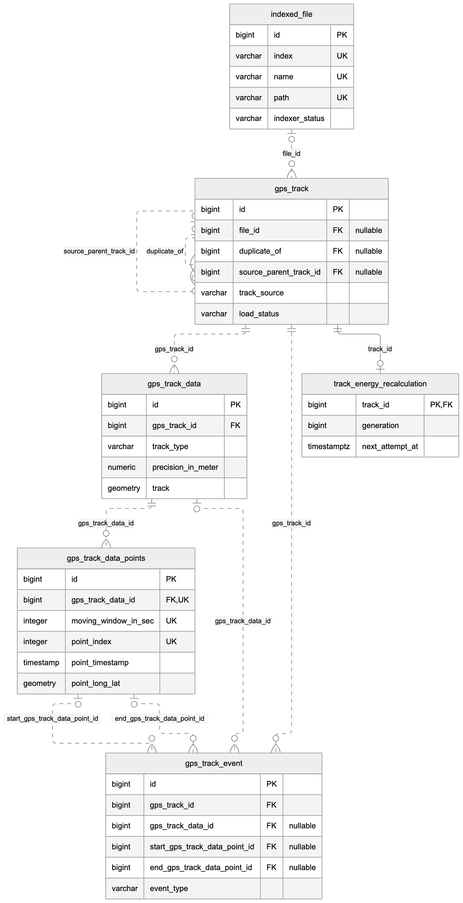
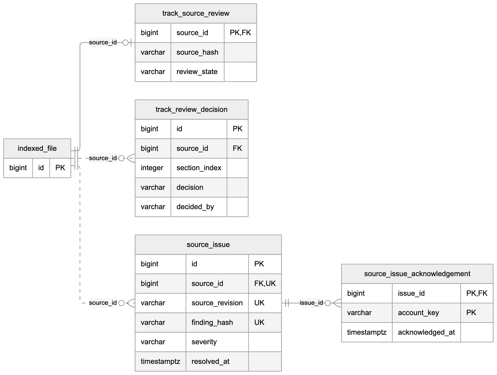
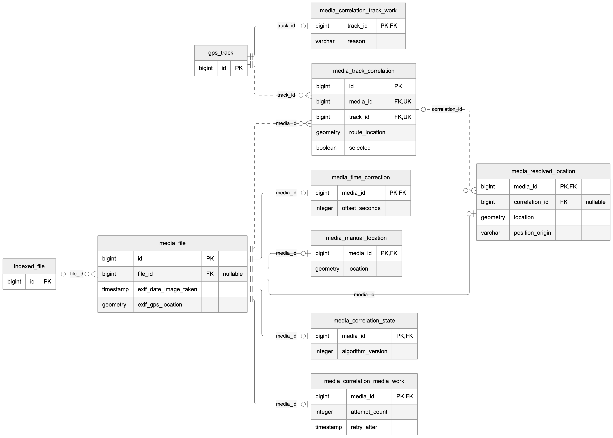
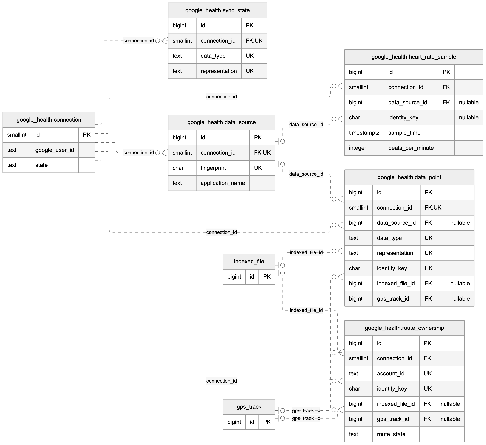
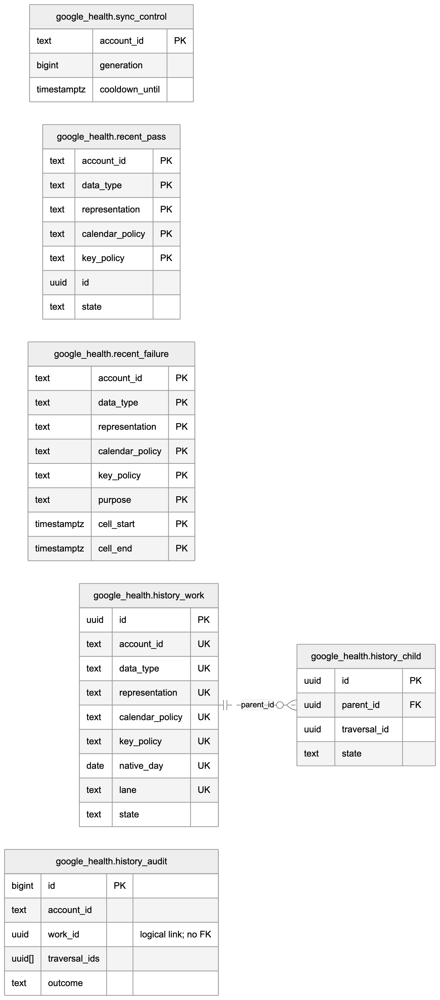
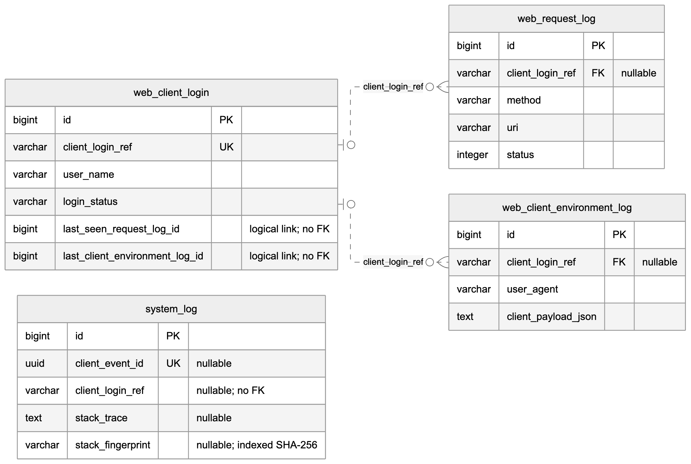

# Database relations

MTL Explorer uses PostgreSQL with PostGIS. These diagrams cover all 38 foreign
keys and list all 42 application tables in the schema through Liquibase change
`111`. Table names without a schema prefix belong to `public`. Only keys and
selected fields are shown; the [Liquibase changelog](../../mtl-server/src/main/resources/db/changelog/db.changelog-master.xml)
defines the complete schema.

## Reading the diagrams

Every line represents an enforced foreign key; its label names the child column.
`PK` means primary key and `FK` means foreign key. `UK` marks a unique key;
multiple fields marked `UK` in a table form one composite key. A circle means zero is allowed,
a bar means one, and a crow's foot means many. Cardinalities describe what the
database allows. Solid lines use a foreign key as part of the child's primary
key; dashed lines use a separate key. Nullable fields are noted where they
affect a relationship.

## Tracks and derived data

[Mermaid source](../../docs/assets/database/tracks.mmd).

An indexed file can produce several tracks. `duplicate_of` and
`source_parent_track_id` reference other rows in `gps_track`. Track geometry,
point calculations, and events are stored separately. Saved plans also use
`gps_track`; `track_source` distinguishes their origin. See [GPS processing](gps/processing.md).

The database owns `gps_track.version`. Metadata writes increment it, and
statement triggers on `gps_track_data` also revise each affected parent once per statement
when stored geometry variants are inserted, updated, moved or deleted.
An import inserts each geometry variant separately, so it advances the version
several times. Version-only updates do not create metadata audit snapshots
([change 112](../../mtl-server/src/main/resources/db/changelog/changes/112.xml)).
Individual point writes do not invoke these triggers. This lets the client
reuse unchanged track caches while refreshing metadata and all geometry
precisions for revised tracks. See [change 111](../../mtl-server/src/main/resources/db/changelog/changes/111.xml).

Cache reuse assumes one database history. The [restore procedure](../administration/maintenance/backup-and-restore.md)
rotates the installation identity before startup, including restores to the same
address. Browsers also discard the cache when a freshness revision decreases.
An unannounced restore whose counters have already caught up cannot be detected
from IDs and versions alone; rotating the identity is required.

## Source review and acknowledgements

[Mermaid source](../../docs/assets/database/source-review.mmd).

Source reviews, use decisions, and issues refer to the indexed file. An issue
can have one acknowledgement per `account_key`; that key is an authenticated
account name, with no database account table. See [source issues](source-issues.md).

## Media and track correlation

[Mermaid source](../../docs/assets/database/media.mmd).

Media and tracks are related through `media_track_correlation`. Its composite
unique key permits one candidate per media/track pair. A partial unique index
allows at most one selected candidate per media file. Corrections, resolved
locations, calculation state, and work queues have at most one row per owning
media file or track. See [media correlation](media/correlation.md).

## Google Health records and route ownership

[Mermaid source](../../docs/assets/database/health-records.mmd).

The `google_health` schema isolates connection state and imported Health
records. `connection.id` is constrained to `1`. Routes can refer to normal
indexed files and GPS tracks; deletion of those public rows sets the Health
references to null. Deleting a connection cascades to `sync_state`,
`data_source`, `data_point`, and `heart_rate_sample`. The `route_ownership`
connection reference has no cascade.

Heart-rate identity uniqueness uses partial indexes: named records use
`(connection_id, identity_key)` and unnamed records use
`(connection_id, sample_time, identity_key)`. These are omitted from the field
key markers. See [Health synchronization](health/synchronization.md).

## Google Health synchronization work

[Mermaid source](../../docs/assets/database/health-work.mmd).

`history_child.parent_id` is the only foreign key in this group. Account-scoped
tables share the Google account ID by application convention. Their
`account_id` columns have no foreign key to `connection.google_user_id` or
`sync_control`. `history_audit.work_id` and `traversal_ids` retain logical
work/traversal references without foreign keys.

## Client login and request logs

[Mermaid source](../../docs/assets/database/client-logs.mmd).

Both log tables reference the unique `client_login_ref`, rather than the login
row's `id`. A log may have no login reference. The login's last-log IDs are
application links without foreign keys. `system_log.client_login_ref` also has
no foreign key. Its nullable `stack_fingerprint` has a non-unique index and is
calculated from the full captured stack when a client report is submitted.
Existing rows retain null. See [diagnostic logging](diagnostic-logging.md).

## Tables without foreign keys

These nine public tables complete the application table inventory.

| Table | Purpose |
| --- | --- |
| `config` | Stored settings, keyed by `id` |
| `filter_config` | Filter definitions, keyed by `id` |
| `data_freshness` | Domain revisions, keyed by `domain_key` |
| `system_log` | Server and client diagnostics, keyed by `id` |
| `indexed_file_audit` | Indexed-file change snapshots |
| `gps_track_audit` | Track change snapshots |
| `media_file_audit` | Media change snapshots |
| `config_audit` | Setting change snapshots |
| `filter_config_audit` | Filter change snapshots |

Audit tables retain copied IDs and values without primary or foreign keys.
They can retain history after deletion of the source row.

## Views and infrastructure

`gps_track_v` joins tracks, indexed-file metadata, and derived geometry.
`media_file_v` joins media and indexed-file metadata. These are query views,
with no independent primary or foreign keys.

Liquibase's `databasechangelog` and `databasechangeloglock`, PostGIS's
`spatial_ref_sys`, and the PostGIS metadata views are excluded from the
application table count.

Diagram editing and rendering are described in the [asset notes](../../docs/assets/database/README.md).

## Read-only database access

Dynamic SQL uses the separate `mtluserreadonly` pool. New databases create the
role without a password. After Liquibase completes, startup applies
`MTL_DB_READONLY_PASSWORD` before opening that pool. An unset or blank value
uses the configured primary database password. PostgreSQL quotes both the role
and credential; the credential is excluded from startup diagnostics. Existing
databases use the same startup path. The table and relation diagrams are unchanged.
