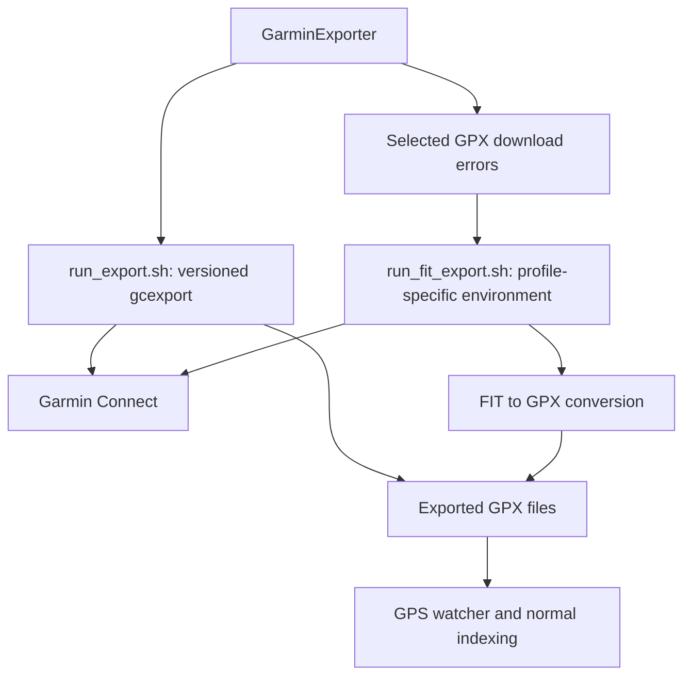

# Garmin export flow

MTL Explorer runs two community helpers from `GarminExporter`. The exporter
ensures the configured helper version/profile is installed, writes the known
activity-ID exclusion file, then starts the primary GPX export.

## Helper interfaces

| Helper | Arguments | Environment |
| --- | --- | --- |
| `garmin_export/run_export.sh` | username, password, exclude file, gcexport version | `venv_gcexport_<version>` and `gcexport_src_<version>` |
| `garmin_fit_export/run_fit_export.sh` | username, password, activity ID, save directory, optional profile (default `default`) | `venv_fit_<profile>` |

`install_gcexport.sh` and `install_fit_export.sh` create the corresponding
environments during the image build or through runtime tool management.
The [Dockerfile](../../Dockerfile) owns default versions and packages.

The primary wrapper exports into its versioned source directory, then copies
`GARMIN_CONNECT_EXPORTED_TRACKS` without overwriting existing files into
`/app/gpx/`. This path is currently fixed in the wrapper. The standard Compose
watcher instead uses `/app/mtl-data/gpx`; Garmin setup therefore needs the
additional mount described in [Garmin setup](../administration/garmin.md).

The FIT fallback uses `mtl.garmin-sync.fit-export-save-dir`, set to the watched
directory by Compose. It retains `activity_<id>.fit` and writes
`activity_<id>.gpx`. See [the FIT helper](../../docker/garmin_fit_export/README.md).

## Failure handling

The intended fallback is a failed GPX download, commonly a timeout. The current
parser actually selects log lines matching `\[ERROR\].*?gpx/activity/(\d+)`;
it does not require the text `408`. It deduplicates the captured IDs and retries
them through FIT export. A generic error with no matching activity URL cannot
select an activity for retry. FIT requests can also fail.

The server captures helper output and reports export duration, retry results,
and errors. A completed export and completed indexing are separate milestones.
Open **Settings → Import & sync → Garmin** for command output and
**Settings → Processing** for indexing. Helper installation controls are under
**Settings → Maintenance → Advanced tools**.

Sync remains optional and disabled by default. Configure credentials privately;
the [Garmin setup guide](../administration/garmin.md)
describes the required configuration and mounts.
