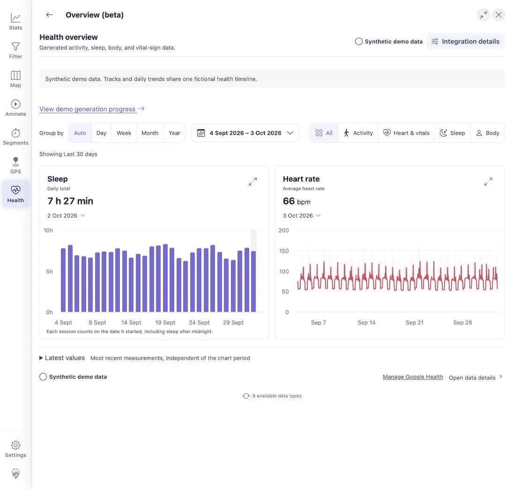

# Health charts

Open **Health** from the navigation, or **More → Health** on a phone. Choose
**Overview** for charts or **Data & Records** for the raw data. **Back** returns
to this choice.

## Use the charts

1. Choose a date preset, or set your own range and click **Apply**.
2. Choose the grouping: Auto, Intraday, Day, Week, Month, or Year. Weeks start on Monday.
3. Point at a bar, or click or tap it, to see details for that period.

- Activity charts show totals or daily variation.
- Sleep is counted on the day it started, including naps. A night is not split
  at midnight.
- Measurements show averages, and optionally the range of values.
- **Expand** a chart for more room; **Back** or Escape returns.
- **Latest values** shows your most recent values, which can be outside the
  selected dates.

Chart preferences are saved in this browser.

## See readings within a day

1. Choose **Intraday** under **Group by** in **Overview**, or open a day's
   details on a daily chart and choose **See day in detail**.
2. Choose a day, or use the arrows to move between days.
3. Choose a time window above the charts, such as **1 h** or **15 min**, and use
   the arrows beside it to move earlier or later. You can also drag or pinch on
   any graph. All graphs show the same time window.
4. To enter exact times, choose the time range, set **From** and **To**, and
   choose **Apply**. For example, enter **12:00** and **12:15**.
5. Select a point to mark that time on every graph and see each reading.
   **Full day** shows the whole day again.

Each point shows the average for one second. **Average & range** also shows the
lowest and highest readings in that second. A break in the line shows a time
without readings.

Intraday detail is available for heart rate and timestamped weight, body fat,
body temperature, and blood glucose measurements. The detail depends on what
your device recorded and Google supplied. Choose **Day** or a coarser grouping
for daily totals and other daily measurements.

