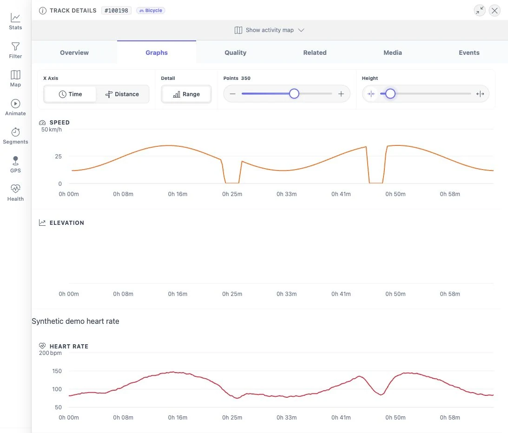

# Heart rate on tracks

You can record a track on a Garmin while wearing a Fitbit, for example. After
the track is imported and Google Health has synced, MTL Explorer adds your heart
rate to the track by matching the times. The two devices don't need to be
connected.

This needs a track with real timestamps and heart-rate data for the same time.

## Where you see it

- **Overview:** average, minimum, and maximum heart rate. The normal average
  includes stops; the moving average only counts time in motion.
- **Graphs:** heart rate next to speed and elevation. Parts without heart-rate
  data stay empty.
- **Segments:** average heart rate per attempt, and cardiac cost (heartbeats per
  unit of work). This compares heart rate with the estimated work; it is not a
  fitness score.

Your health data stays on your own installation. See
[segment analysis](../../architecture/analysis/segments.md) and
[motion analysis](../../architecture/gps/motion.md) for the calculations.
